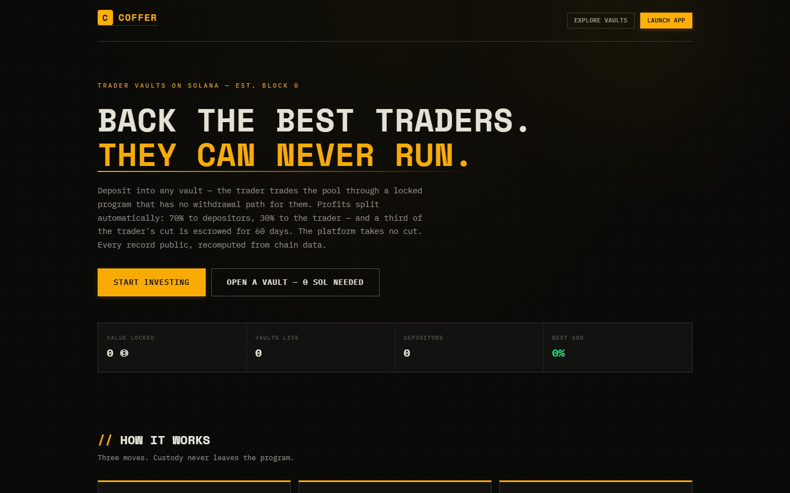
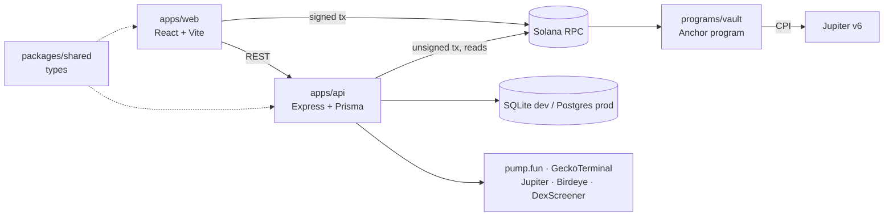

# Trader Vaults

[](https://github.com/omarpatel/trader-vaults/actions/workflows/ci.yml)
[](LICENSE)


Non-custodial trader vaults on Solana: investors pool capital, a trader trades it, and the program makes withdrawal by the trader impossible.



## Overview

A trader opens a vault and investors deposit SOL into it. Custody sits in a program-owned PDA controlled by an Anchor program that exposes a scoped swap instruction (pinned to the Jupiter v6 router) and a withdrawal path that pays depositors only — there is no instruction that moves vault funds to an arbitrary account. Around the program sits a web app with a trading terminal, token discovery and a fully separated paper-trading sandbox. The program is not deployed; live trading, withdrawals and an external audit are not complete, and mainnet execution is gated behind an explicit opt-in flag.

## Features

- **Program-enforced custody** — Anchor vault program with PDA custody, per-depositor accounting and a CPI-restricted swap path.
- **User-signed deposits** — depositors sign transactions client-side with a Privy embedded (self-custodial) wallet; the server only builds unsigned transactions.
- **Per-depositor performance fees** — charged above each depositor's high-water mark on realised profit, with part of the trader fee vested in escrow.
- **Trading terminal** — candlestick charts at 1s/15s/30s/1m/5m/15m/1h in USD, SOL or market cap, with a live trade tape.
- **Market data with named sources** — pump.fun native candles and trades with GeckoTerminal fallback; tiered pricing via Jupiter, Birdeye, DexScreener and pump.fun, with stale markers instead of fabricated values.
- **Pulse board** — new, graduating and graduated token lifecycle columns.
- **Paper trading** — the same engine at live prices, isolated from real vault track records.
- **Leaderboards, trader profiles, wallet tracking and portfolio views.**
- **Demo mode** — runs without configuration on a seeded local dataset.

## Architecture



`packages/shared` defines every API response shape and is the contract between the web app and the API.

## Tech stack

- **Frontend:** React, Vite, TypeScript, Privy (`@privy-io/react-auth`), lightweight-charts
- **Backend:** Node.js 20+, Express, Prisma, `tsx`
- **On-chain:** Rust, Anchor, `@solana/web3.js`
- **Database:** SQLite (development), PostgreSQL (production)
- **Deployment:** Railway / Nixpacks configuration, GitHub Actions

## Getting started

Requirements: Node.js 20 or newer. The Anchor toolchain is only needed to build the program in `programs/vault`.

```bash
npm install
npm run db:setup   # prisma db push + seed
npm run dev        # API on :8787, web on :5173
```

Without environment configuration the app runs in demo mode. To use your own Privy app, database and RPC:

```bash
cp .env.example .env
```

Other scripts:

| Command | Purpose |
|---|---|
| `npm run dev:api` / `npm run dev:web` | Run one side only |
| `npm run typecheck` | Type-check API and web |
| `npm run build` | Generate Prisma client and build API and web |
| `npm run start:prod` | Start the compiled API |

See `programs/vault/README.md` for building and testing the on-chain program.

## Project structure

| Path | Contents |
|---|---|
| `apps/web` | React frontend: investor and trader views, terminal, discovery, paper trading |
| `apps/api` | Express API, Prisma schema, market-data and on-chain services |
| `packages/shared` | Shared TypeScript types and formatting helpers |
| `programs/vault` | Anchor vault program and its tests |
| `scripts` | Deployment, migration and on-chain end-to-end scripts |
| `docs` | Deployment record, audit preparation and design notes |

## License

MIT — see [LICENSE](LICENSE).
